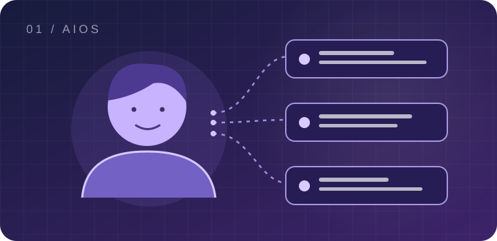
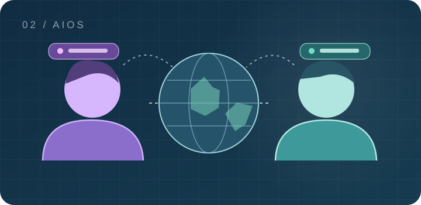
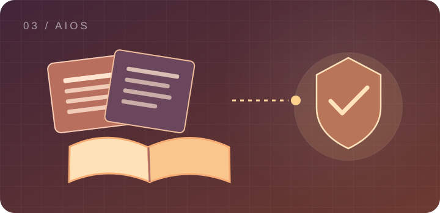
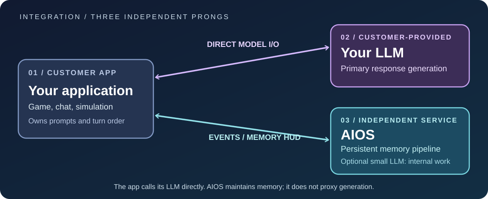

<p align="center">
  
</p>

<h1 align="center">AIOS</h1>

<p align="center"><strong>Persistent memory, world state, and work for AI characters and agents.</strong></p>
<p align="center">
  AIOS is a self-hosted backend that gives characters a history they can draw on and projects
  they can pick up again. Use SillyTavern through MemoryVaultIngest or connect your own app.
  With AIOS Client, characters can request research and computer tasks in an authorized workspace.
</p>

<p align="center">
  <a href="#what-can-you-build">What can you build?</a> ·
  <a href="#use-aios-with-sillytavern">SillyTavern</a> ·
  <a href="#run-tasks-with-aios-client">AIOS Client</a> ·
  <a href="#quick-start">Quick start</a> ·
  <a href="#connect-your-application">Connect an app</a> ·
  <a href="docs/README.md">Developer docs</a> ·
  <a href="#dependencies">Dependencies</a>
</p>

## What can you build?

<table>
  <tr>
    <td width="50%" valign="top">
      
      <h3>Persistent characters and companions</h3>
      <p>Resume a roleplay scene or a long-running conversation with the same character identity and relevant prior experiences. AIOS tracks those experiences alongside the current scene.</p>
    </td>
    <td width="50%" valign="top">
      
      <h3>Separate perspectives in one world</h3>
      <p>Give characters in the same game or simulation different experiences and beliefs. A character’s context follows its own timeline and knowledge, alongside the world information available to it.</p>
    </td>
  </tr>
  <tr>
    <td width="50%" valign="top">
      
      <h3>Research with sources <em>(experimental)</em></h3>
      <p>Import documents or lorebooks into a shared corpus and let individual agents acquire selected material with source references. With AIOS Client and explicit grants, an agent can request research using local documents, Calibre OPDS, or SearXNG and revisit the returned evidence and limitations.</p>
    </td>
    <td width="50%" valign="top">
      <h3>Projects that carry over between runs <em>(experimental)</em></h3>
      <p>Keep a managed goal, an advisory plan, and a private project notebook. A due reminder can bring the goal back for review while the chat client is closed. An authorized AIOS Client can inspect files, run configured workspace tasks, and return checks and reports for later review.</p>
    </td>
  </tr>
</table>

The AIOS toolkit includes project notes and research familiar from [ChatGPT Projects](https://help.openai.com/en/articles/10169521-projects-in-chatgpt)
and [Grok](https://docs.x.ai/grok/overview), along with persistent memory, scheduling, and
computer tools found in [Hermes Agent](https://hermes-agent.nousresearch.com/docs/user-guide/features/overview).
These tools build on the timeline, knowledge, and goals AIOS already tracks for each character.

## Use AIOS with SillyTavern

Install [MemoryVaultIngest](https://github.com/LeetHappyfeet/extension-MemoryVaultIngest/tree/development)
in SillyTavern and set its **AIOS URL**. The extension syncs chat events and adds the
character’s current **HUD** to the model prompt. SillyTavern remains the chat interface
and calls your chosen model.

## Run tasks with AIOS Client

Install [AIOS Client](https://github.com/LeetHappyfeet/AIOS_Client/tree/development) on the
machine that will run computer or research tasks. Start its listener and authorize the
workspace in AIOS under **Workspace Delegation**. With automatic routing set up, matching
chats can attach to the workspace and see task results in the character’s HUD. See
[workspace setup](docs/workspace-client.md) for pairing and approvals.

## See the integration work

The dependency-free Python example creates or resumes a session, sets up two participants,
ingests a message, and prints the **HUD** for the next model call.

With AIOS running, execute from the repository root:

```bash
python3 examples/live_client.py --conversation readme-demo-001 --turn 1 \
  --message 'The brass key is on the kitchen table.'
```

Supply `--reply` to record a model response:

```bash
python3 examples/live_client.py --conversation readme-demo-002 --turn 1 \
  --message 'The brass key is on the kitchen table.' \
  --reply 'I will look for the brass key on the kitchen table.'
```

Add your provider call at the marked point. Reuse the conversation key across reconnects
and advance `--turn` for each new exchange.

See the [curl walkthrough](docs/integration.md) and [Python client](examples/live_client.py).

## Quick start

**Requirements:** Linux/Bash environment, Python 3.10+, Git, and Docker with Compose v2.
On Windows, use WSL with Docker access. Setup prepares Python and starts PostgreSQL, Qdrant,
and Apache Jena Fuseki.

```bash
git clone --branch AIOS-development https://github.com/LeetHappyfeet/AIOS.git
cd AIOS
bash setup.sh
AIOS_API_HOST=127.0.0.1 AIOS_UI_HOST=127.0.0.1 bash run.sh
```

Wait for the launcher to report:

```text
✅ AIOS READY
   Required services: 4/4 ready
```

| Where | Default local address |
|---|---|
| Web interface | `http://127.0.0.1:7860` |
| HTTP API | `http://127.0.0.1:8000` |
| Interactive API reference | `http://127.0.0.1:8000/docs` |
| OpenAPI schema | `http://127.0.0.1:8000/openapi.json` |

Check API health.

```bash
curl --fail-with-body http://127.0.0.1:8000/healthz
# {"ok":true}
```

Then run the example above. To stop native processes, press `Ctrl+C`; to also stop
the Compose services, run `bash stop.sh`. Persistent volumes are preserved.
**Do not run `docker compose down -v` unless you intend to delete the databases.**

See [installation and troubleshooting](docs/installation.md) for setup and upgrades.
The [Colab demo](https://colab.research.google.com/drive/1c-eaLVuAu76JSgD4-rr65WvPFwzXA1zK?usp=sharing)
is an alternative experimental introduction.

## Connect your application

<p align="center">
  
</p>

Your application controls its UI, turn order, and calls to its primary LLM. It sends events
to AIOS over HTTP and retrieves a **HUD**, a view of the relevant character and timeline for
the next model call. The HUD can include memories, beliefs, scene state, active goals, and
available work capabilities. Configured inference providers handle background decisions
such as goal planning and reminder review separately from your application's model calls.

The normal live-agent sequence is:

1. `POST /session` — create or resume an external conversation using stable `source` and `source_session_id`.
2. Bootstrap both participant identities, then `POST /character/{character_id}/activate` for each actor in the intended shared world.
3. `POST /ingest` — record the incoming message with explicit speaker/recipient IDs and a unique logical-message `dedupe_key`.
4. `POST /instance/{instance_id}/hud?through_node_id={node_id}` — use the `node_id` from ingestion, and check `generation_ready` before invoking your model.
5. **Your application** sends the prepared HUD `text` alongside its own instructions directly to **your LLM**. The application then records the generated reply separately through AIOS `POST /ingest`.

For example, once the [tutorial's participant setup](docs/integration.md) has supplied
`SESSION` and `INSTANCE`, a typical user-message body looks like this:

```json
{
  "session_id": "<SESSION UUID>",
  "character_id": "docs-guide",
  "user_name": "docs-human",
  "scope_key": "conversation",
  "speaker_type": "user",
  "speaker_id": "docs-human",
  "recipient_id": "docs-guide",
  "kind": "chat_message",
  "text": "The brass key is on the kitchen table.",
  "payload": {"source": "developer-demo"},
  "dedupe_key": "readme-demo:turn-1:user:revision-1"
}
```

Pass the returned `node_id` to the HUD endpoint.

```bash
curl --fail-with-body -sS -X POST \
  "http://127.0.0.1:8000/instance/$INSTANCE/hud?through_node_id=$NODE&wait_ms=2500"
```

Use `hud["text"]` only when `generation_ready` is true for the current source coordinate.
Ingestion success alone does not imply asynchronous enrichment or HUD preparation has finished.
A stale-coordinate HTTP 409 is a state conflict, not a reason to silently fall back to old memory.
The [complete, executable curl walkthrough](docs/integration.md) fills in the setup and identifiers;
the [API guide](docs/api.md) documents requests, responses, and error handling.

**Network access.** The development API has no common authentication scheme. Use the
loopback bindings above for a local install. Configure an authenticated access boundary
before exposing the service beyond the local machine.

## Dependencies

AIOS uses PostgreSQL, Apache Jena Fuseki, and Qdrant.

## Documentation

| I want to… | Start here |
|---|---|
| Install or troubleshoot AIOS | [Installation](docs/installation.md) |
| Connect a chatbot, game, or external program | [First integration tutorial](docs/integration.md) and [example client](examples/live_client.py) |
| Look up HTTP requests, responses, and errors | [API guide](docs/api.md) or the running `/docs` endpoint |
| Delegate computer or research tasks | [Workspace setup](docs/workspace-client.md), [Work admission](docs/work-admission.md), and [Client research sources](https://github.com/LeetHappyfeet/AIOS_Client/blob/development/docs/research.md) |
| Follow a project across runs | [Goal planning](docs/goal_planning_v1.md), [Reminders](docs/background-reminder-prompts.md), [Project notebooks](docs/project-notebooks-pass-a.md), and [Retained work evidence](docs/hud-work-evidence.md) |
| Operate services or configure inference | [Runtime operations](docs/runtime.md) |
| Inspect a message, missing memory, or failed job | [Inspection and troubleshooting](docs/inspection.md) |
| Understand the internal design | [Architecture](docs/architecture.md), [Identity Kernel](docs/identity_kernel.md), [Belief Reconciliation](docs/belief_reconciliation.md), and [Causal Integrity](docs/causal_integrity.md) |
| Explore further subsystems | [Semantic Index](semantic_index/README.md), [Plugin System](plugins/README.md), and [RDF Ontology](rdf/ontology/readme.md) |

## Development and license

**Development status.** AIOS is experimental and under active development. Internal schemas,
APIs, memory and belief policies, and cognition components may change. Pin the commit used by
your integration and export that
server's `/openapi.json` before upgrading. Reports accompanied by logs and a reproducible
source interaction are welcome.

AIOS is **source-available proprietary software**, not open-source software. Personal use,
study, experimentation, and private modification by natural persons are permitted under the
[AIOS Personal Use License 1.0](LICENSE). Commercial, organizational, institutional, hosted,
and service-provider use requires a separate written license. Earlier versions released under
Apache License 2.0 retain the license applicable to those versions.
